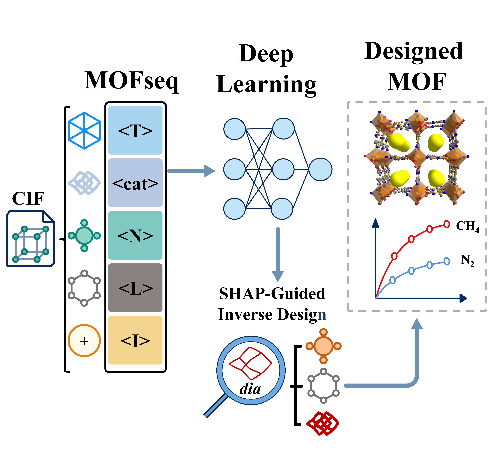
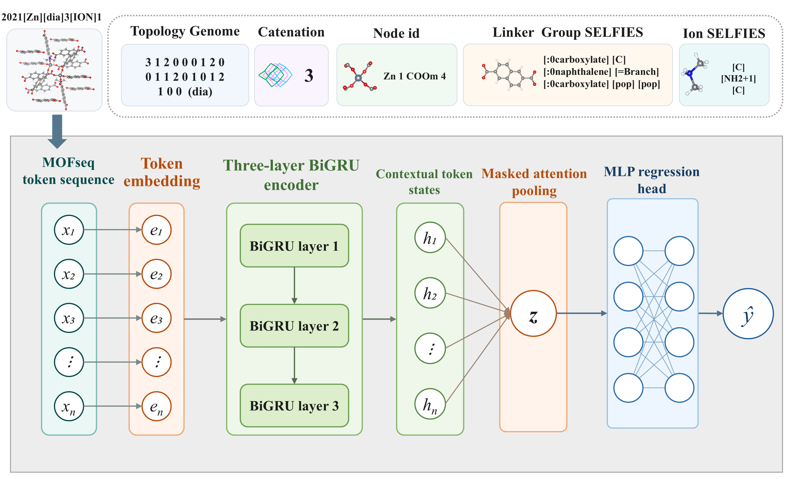

# MOFseq-InverseDesign

Interpretable inverse design of MOFs for CH<sub>4</sub>/N<sub>2</sub> separation using MOFseq, deep learning, and structural attribution.

<p align="center"></p>

## MOFseq and model architecture

MOFseq encodes the topological genome, interpenetration, metal-node environments, Group SELFIES linkers, and charge-balancing ions. Token embeddings pass through a three-layer bidirectional GRU, masked attention pooling, and an MLP regression head. Separate models predict CH<sub>4</sub>/N<sub>2</sub> selectivity and  CH<sub>4 </sub>mixture uptake.

<p align="center"></p>

## Code

- `model.py`: neural network, checkpoint loading, and prediction.
- `utils.py`: sequence parsing, batching, file handling, and summary helpers.
- `ML_training.py` / `ML_predict.py`: training and prediction workflows.
- `SHAP_stage1_topology.py`: exact topology masking attribution.
- `SHAP_stage2_dia.py`: feature grouping, Kernel SHAP, and chemical-family aggregation.

## Requirements

Python **3.10-3.12**. All dependencies, including the linker-encoding packages, are listed in `requirements.txt`. Install Git first (required for Group SELFIES), then run:

```bash
python -m pip install -r requirements.txt
```

No virtual environment is distributed. CPU and CUDA are supported; add `--device cpu` to select CPU execution.

## Data and models

- `data/train.csv.gz`, `val.csv.gz`, and `test.csv.gz`: 149,058 / 18,632 / 18,632 records. Read directly without extraction.
- `data/attribution_samples.csv.gz` and `dia_samples.csv`: 3,136 first-stage and 161 second-stage attribution samples.
- `data/example_mofseq.csv`: five randomly sampled training MOFs (seed 42), for prediction examples only.
- `models/`: the two original pretrained models.

## Usage

Run from the project folder:

```bash
python ML_predict.py --input data/example_mofseq.csv --output results/predictions/new.csv
python ML_training.py --task selectivity
python ML_training.py --task ch4_uptake
python SHAP_stage1_topology.py --overwrite
python SHAP_stage2_dia.py --overwrite
```

To predict with a retrained model:

```bash
python ML_predict.py --checkpoint results/training/YOUR_RUN/best_model.pt --input data/example_mofseq.csv --output results/predictions/retrained.csv
```

Input CSVs require a `MOFseq` column. Optional linker encoding and sequence assembly:

```bash
python MOFseq_encoding.py encode --input your_linkers.csv --output results/linkers_encoded.csv
python MOFseq_encoding.py assemble --input your_fields.csv --output results/candidates.csv
```

Use `--help` for other arguments. Predictions describe selectivity and CH4 **mixture uptake** at 298 K, 1 bar, CH4/N2 = 50:50, not pure-component uptake. 
